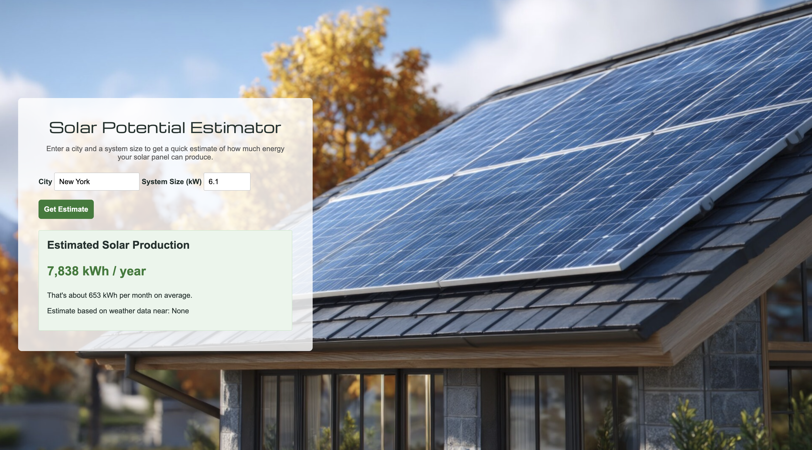

# Solar Potential Estimator ☀️

A page that estimates how much energy a solar panel system could make in a year for any city.

## Description

This is a project I built to practice using more than one API in a row. You type in a city and the size of a solar panel system in kilowatts. The page finds where that city is, then asks a solar calculator how much electricity that system could make there in a year, based on local weather data. It shows the estimated kWh per year and the average per month. It uses plain HTML, CSS, and JavaScript with `fetch`, so there is no server to run. The numbers are rough estimates, not a quote from an installer.

## Screenshot

## Features

- Enter any city and a system size in kW
- Shows the estimated energy per year in kWh
- Shows the average per month
- Shows which weather data the estimate is based on
- Friendly messages if the city can't be found or the data can't be loaded
- Solar panel photo background

## Tech Used

- HTML
- CSS
- JavaScript
- `fetch` and promises (`.then()` and `.catch()`)
- [PVWatts API](https://developer.nlr.gov/) (the solar energy calculator)
- [Open-Meteo Geocoding API](https://open-meteo.com/en/docs/geocoding-api) (turns a city into a latitude and longitude)

## How to Use

This app doesn't need a server. The PVWatts calculator needs a free API key.

1. Download or clone the project.
2. Open `js/main.js` and put your key in the `apiKey` variable at the top.
3. Open `index.html` in your browser (or use the Live Server extension in VS Code).
4. Type a city and a system size (for example, 5 kW is a typical home system).
5. Click **Get Estimate**.

**A note about keys:** this page runs in the browser, so the key is visible to anyone who opens the page's code. Only use a free key you can replace.

## How It Works

1. When you submit the form, `main.js` reads the city and the system size.
2. It uses `fetch` to ask the geocoding service for the latitude and longitude of the city. If the city isn't found, it shows a message.
3. It sends that latitude and longitude, plus the system size and some standard settings (like panel tilt and energy losses), to PVWatts.
4. PVWatts answers with the expected energy for the year. The page rounds it, works out the monthly average, and shows it.

## What I Learned

- How to chain two API requests so the second one uses the answer from the first
- How to build a web address with `URLSearchParams`
- How to turn a city name into latitude and longitude
- How to handle errors so the user sees a helpful message
- How to set a background image with CSS
- How to fix a project when an API changes its address and what it accepts

VIEW APP HERE: https://solar-jcji.onrender.com/

## Author

Maya Rose 🌹
